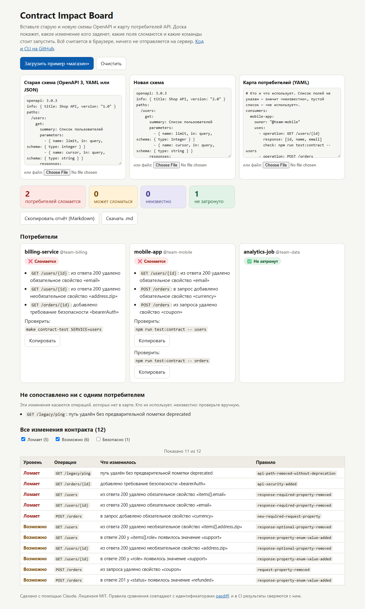

# Contract Impact Board

[](https://github.com/Oleg4311/contract-impact-board/actions/workflows/ci.yml)
[Доска онлайн](https://oleg4311.github.io/contract-impact-board/) · [Релизы](https://github.com/Oleg4311/contract-impact-board/releases)

**Кого заденет изменение API?** Загрузите старую и новую схемы OpenAPI и карту потребителей (кто и какие поля читает). Доска покажет, какое изменение кого сломает, какие поля и операции затронуты и какие команды проверки запустить. Всё считается в браузере; есть и CLI для CI.



*English: given two OpenAPI 3 specs and a YAML map of API consumers, it classifies contract changes (breaking / maybe / safe) and translates them into "who is affected, which fields, what to re-test". Browser board + zero-dependency CLI. See the [English section](#english).*

## Зачем

Инструменты вроде [oasdiff](https://github.com/oasdiff/oasdiff) отвечают на вопрос «что изменилось и что из этого ломающее». Но ответ «удалено обязательное свойство `email`» не говорит, **чей** мобильный клиент или сервис это читает. Эта доска добавляет второй слой: карту потребителей. Из неё видно, что удаление `email` ломает двух потребителей из трёх, а третий читает только `id` и `name`.

## Как пользоваться

**В браузере:** откройте [доску](https://oleg4311.github.io/contract-impact-board/), нажмите «Загрузить пример» или вставьте свои три файла. Отчёт можно скопировать в Markdown (удобно для описания pull request) или скачать.

**В CI (CLI одним файлом, без зависимостей):**

```bash
node contract-impact.mjs old.yaml new.yaml consumers.yaml --fail-on broken
# --format text | markdown | json    --fail-on broken | warn | unknown
```

Код выхода 1, если есть потребитель с указанным статусом или хуже; 2 — ошибка ввода. Скачайте `contract-impact.mjs` со страницы [Releases](https://github.com/Oleg4311/contract-impact-board/releases) и проверьте:

```bash
sha256sum -c SHA256SUMS
gh attestation verify contract-impact.mjs --repo Oleg4311/contract-impact-board
```

## Карта потребителей

```yaml
consumers:
  mobile-app:
    owner: "@team-mobile"
    uses:
      - operation: GET /users/{id}
        response: [id, name, email]            # поля ответа, которые читает потребитель
        check: npm run test:contract -- users  # что запустить, если затронут
      - operation: POST /orders
        request: [items, coupon]               # поля тела, которые он отправляет
        response: [id, total]
        parameters: [limit]                    # используемые параметры
```

Поля пишутся через точку, массивы — `items.sku` или `items[].sku` (одно и то же). Объект целиком (`address`) пересекается с любым его полем (`address.zip`).

**Статусы потребителя:**

| Статус | Когда |
|---|---|
| ❌ сломается | изменение уровня «ломает» затрагивает операцию и поля, которые он использует |
| ⚠️ может сломаться | затронуто только изменение уровня «возможно» (например, удалено необязательное поле) |
| ❔ неизвестно | потребитель не указал список полей, а операцию изменили: честнее признать, что мы не знаем |
| ✅ не затронут | изменений в его операциях и полях нет |

Список полей **не указан** — значит «неизвестно», **пустой** (`response: []`) — осознанное «не использую». Изменения в операциях, которых нет ни в одной карте, выводятся отдельным разделом «не сопоставлено», а записи карты, которых нет в схемах (опечатка, устаревшая карта), — разделом «устаревшие». Новое обязательное свойство или параметр запроса, а также появление авторизации у открытой операции касаются любого, кто вызывает операцию, независимо от перечисленных полей.

## Какие изменения распознаются

Идентификаторы правил совпадают с oasdiff, например `response-required-property-removed`, `new-required-request-property`, `request-parameter-became-required`, `api-security-added`, `api-path-removed-without-deprecation`.

- **Операции и пути:** удаление (с пометкой deprecated и без), добавление.
- **Параметры:** удаление, новый обязательный/необязательный, стал обязательным/необязательным, смена типа, убранное значение enum.
- **Тело запроса:** новое обязательное/необязательное свойство, удалено, стало обязательным, смена типа и формата, убранное значение enum, тело стало обязательным.
- **Ответы:** удалено обязательное/необязательное свойство, стало необязательным, смена типа, добавленное/убранное значение enum, убран успешный/ошибочный статус, убран тип содержимого.
- **Безопасность:** требования — альтернативы («или»): ещё один способ клиента не ломает; ломает появление авторизации у открытой операции и убранный способ.
- Поддерживаются `$ref` внутри документа, `allOf` (объединение), `oneOf`/`anyOf` (свойства вариантов считаются необязательными), рекурсивные схемы, массивы и вложенность.

## Что проверено

- **59 юнит-тестов:** каждое правило на минимальной паре схем (с проверкой уровня), `$ref`/`allOf`/`oneOf`/циклы, ошибки разбора, карта потребителей, сценарий «магазин» (из трёх потребителей удаление `email` ломает ровно двух), CLI с кодами выхода.
- **Метаморфические проверки:** то, что удалено в одну сторону, должно появиться добавленным в обратную; перестановка ключей в документе не меняет результат.
- **Мутационная проверка:** сломали семь ключевых мест (правила для всей операции, пересечение путей, учёт предков, статус «неизвестно», «стало необязательным», защита у открытой операции, расширение типа параметра) — тесты падают.
- **26 браузерных тестов** (десктоп и мобильный), включая доступность (axe) в светлой и тёмной теме в состояниях «с результатом» и «с ошибкой», и проверку, что имена из схемы и карты выводятся как текст, а не разметка.
- **Сверка с настоящим oasdiff в CI:** те же пары схем прогоняются через oasdiff v1.39.0 (скачивается с проверкой sha256), и множества «операция + правило» среди ошибок и предупреждений сравниваются. Первый такой прогон нашёл три неточности в самой доске (безопасность как «или», убранный ответ 404, расширение типа параметра); они исправлены. Одно расхождение осталось осознанным: удаление необязательного свойства из ответа oasdiff показывает только в changelog, а здесь это «возможно», потому что карта потребителей позволяет назвать тех, кто это поле читает (список в `scripts/crosscheck-known.json`).

## Честные ограничения

- **Это не замена oasdiff.** Покрыта часть его правил (список выше), остальные (заголовки ответов, `readOnly`/`writeOnly`, нюансы `nullable`, расширяемые enum, сроки отказа от устаревших операций и др.) пока не реализованы.
- **Только локальные `$ref`** (`#/components/...`). Внешние файлы не загружаются, схема должна быть собрана в один документ.
- **Совпадение операций точное:** переименование пути (`/users/{id}` → `/users/{userId}`) считается удалением и добавлением. oasdiff умеет сопоставлять такие пути, здесь нет.
- **Карта — это ваши сведения.** Доска не знает, что на самом деле читает клиент. Чем точнее карта, тем полезнее ответ; поэтому «неизвестно» выведено отдельным статусом.
- **`oneOf`/`anyOf` разбираются упрощённо:** свойства всех вариантов складываются как необязательные.

## Разработка

```bash
npm ci
npm test            # 59 тестов на node:test (Node 22.18+ запускает .ts без сборки)
npm run typecheck
npm run build       # dist/contract-impact.mjs
npm run site        # собрать доску в site/
npm run e2e         # браузерные тесты (Playwright + axe)
```

Страница публикуется на GitHub Pages; после каждого деплоя workflow проверяет опубликованную версию (`release-receipt`, сверка коммита) и гоняет e2e на живом адресе.

Лицензия: MIT. Сделано с помощью Claude.

---

## English

**Contract Impact Board** turns an OpenAPI diff into an impact report. Inputs: the old and new OpenAPI 3.x specs plus a YAML consumer map (which service reads/sends which fields of which operation, and which command re-tests it). Output: per-consumer status — ❌ will break, ⚠️ may break, ❔ unknown (the consumer did not declare the fields it uses), ✅ unaffected — with the exact changes, fields and check commands; plus changes nobody claims ("unmapped") and stale map entries.

- Rule IDs match [oasdiff](https://github.com/oasdiff/oasdiff) (`response-required-property-removed`, `new-required-request-property`, …); CI cross-checks the same spec pairs against oasdiff v1.39.0 (checksum-verified download).
- Browser board (everything is computed locally) and a single-file zero-dependency CLI: `node contract-impact.mjs old.yaml new.yaml consumers.yaml --fail-on broken`.
- Not a replacement for oasdiff: a subset of its rules, local `$ref` only, exact operation matching.

Releases carry SHA-256 sums and build provenance (`gh attestation verify`). MIT licensed. Built with Claude.
